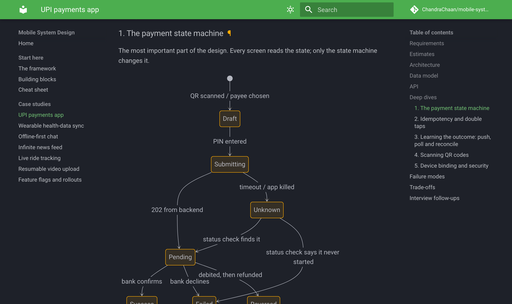
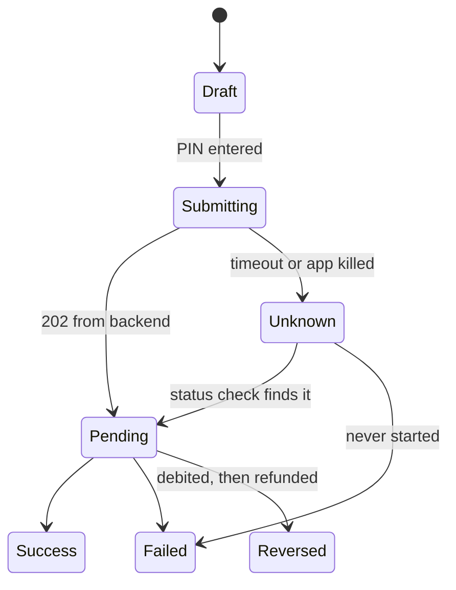

# Mobile System Design

**Worked case studies for mobile system design interviews and real projects: payments, wearables, chat, feeds, live tracking, uploads and safe releases.**

Most system design guides are about servers. Mobile rounds ask different questions:

- What happens if the app is killed **after the user entered their UPI PIN** but before the result came back?
- How does a fitness band's data reach the cloud **exactly once**, after a week offline, with a drifting clock?
- How does a chat stay **in order** when phones' clocks are wrong and the network keeps dropping?
- How do you ship safely when **a mobile release can't be rolled back**?

Each case study answers questions like these with diagrams, data models, APIs, failure modes and trade-offs, the way you'd explain them in an interview.

📖 **[Read it as a website](https://chandrachaan.github.io/mobile-system-design/)**, with search and dark mode, or browse the Markdown below.

  

## Contents

**Start here**

1. [The framework](docs/framework.md): seven steps for any mobile design round, and the common mistakes
2. [Building blocks](docs/building-blocks.md): offline-first reads, the outbox, conflicts, real-time updates, pagination, caching, tokens, background work
3. [Cheat sheet](docs/cheatsheet.md): one page for the night before

**Case studies**

| Case study | Difficulty | You'll practise |
|---|---|---|
| [UPI payments app](docs/case-studies/upi-payments-app.md) | 🔴 Senior | Payment state machines, idempotency, reconciliation, device binding |
| [Wearable health-data sync](docs/case-studies/wearable-health-sync.md) | 🔴 Senior | Bluetooth LE, background limits, deduplication, time zones, HealthKit and Health Connect |
| [Offline-first chat](docs/case-studies/offline-first-chat.md) | 🟡 Mid – 🔴 Senior | Outbox, ordering with sequence numbers, receipts, sockets and push |
| [Infinite news feed](docs/case-studies/news-feed.md) | 🟢 Junior – 🟡 Mid | Cursor pagination, images, video, smooth lists, optimistic likes |
| [Live ride tracking](docs/case-studies/live-ride-tracking.md) | 🔴 Senior | Location streams, trip state, smooth maps, battery |
| [Resumable video upload](docs/case-studies/resumable-video-upload.md) | 🟡 Mid – 🔴 Senior | S3 multipart upload, presigned URLs, background transfers |
| [Feature flags and staged rollouts](docs/case-studies/feature-flags-and-rollouts.md) | 🟡 Mid – 🔴 Senior | Remote config, kill switches, experiments, forced updates |

Every case study has the same sections: **requirements → estimates → architecture → data model → API → deep dives → failure modes → trade-offs → interview follow-ups.**

## How to use it

- **Preparing for an interview:** read [the framework](docs/framework.md), then for each case study read only the requirements, close the page and design it yourself in 45 minutes. Then compare, focusing on the failure modes you missed.
- **Interviewing others:** each case study's follow-up questions make good probes, and the failure-mode table is a ready-made rubric.
- **Designing a real feature:** the building blocks and failure-mode tables work as a review checklist.

The designs are platform-neutral, with notes where Android, iOS and Flutter differ.

## Example: the payment state machine

The `Unknown` state is the one most designs forget. [Read why it matters →](docs/case-studies/upi-payments-app.md#1-the-payment-state-machine)

## Contributing

Corrections, better trade-offs and new case studies are welcome. See [CONTRIBUTING.md](CONTRIBUTING.md), or start a [discussion](https://github.com/ChandraChaan/mobile-system-design/discussions) about a design you'd approach differently.

## Related

- [Flutter Architect Handbook](https://github.com/ChandraChaan/flutter-architect-handbook): 67 interview questions from Dart basics to architecture and leadership
- [flutter-production-starter](https://github.com/ChandraChaan/flutter-production-starter): a template app that applies many of these patterns
- [upi_kit](https://github.com/ChandraChaan/upi_kit), [ble_gatt_parser](https://github.com/ChandraChaan/ble_gatt_parser), [ble_device_simulator](https://github.com/ChandraChaan/ble_device_simulator): open-source Dart packages used in the payments and wearable case studies

## License

MIT. See [LICENSE](LICENSE).
