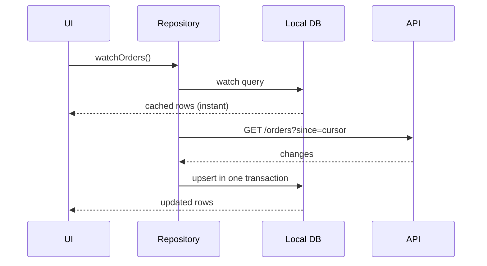
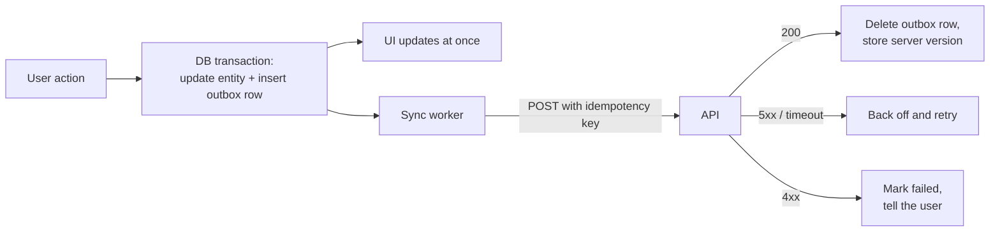
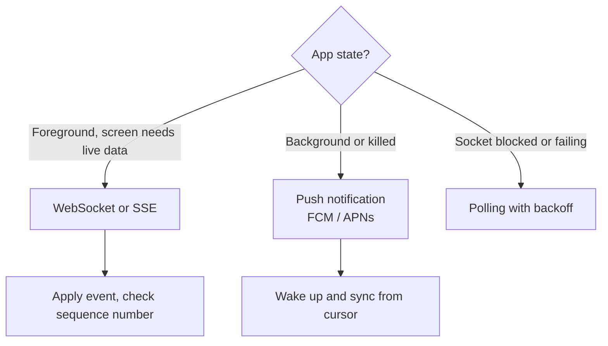

# Building blocks

Patterns that come up in almost every mobile design. Learn them once, then reuse them in each case study.

## Offline-first reads: the database is the source of truth

- The UI **subscribes** to a query (Room `Flow`, Core Data or SwiftData fetch, Drift or Isar `watch()` in Flutter). It never waits for the network to show something.
- The network layer only writes to the database. Every screen showing the same entity stays consistent.
- Store a **sync cursor** (a server timestamp or change token) per collection, so refreshes download only what changed.

**Stale-while-revalidate:** show cached data immediately, refresh in the background, and show "updated 5 min ago" when it matters (prices, balances).

## Offline writes: the outbox

Never call the API directly from a button. Write the change locally, queue it, and let a sync worker send it.

Outbox row: `id`, `entity_id`, `operation`, `payload`, `idempotency_key`, `attempts`, `next_attempt_at`, `created_at`.

Rules:

- **Same transaction:** the entity change and the outbox row are written together, so a crash can't leave one without the other.
- **Idempotency keys:** generated when the user acts, not when the request is sent. A retry reuses the key and the server returns the original result.
- **Order:** send per entity in order. Unrelated entities can go in parallel.
- **Backoff:** exponential with jitter (1 s, 2 s, 4 s … capped at a few minutes). Retry at once when connectivity returns.
- **Run when the app is closed:** Android WorkManager with a network constraint; iOS `BGProcessingTask` or a background `URLSession` for uploads.

## Conflict resolution

Pick per field, not per app:

| Strategy | Use for | Downside |
|---|---|---|
| Last write wins (server timestamp) | Profile fields, settings | Silently loses one edit |
| Server wins and the client reapplies | Anything with business rules (orders, money) | The client must handle rejection |
| Merge per field | Forms edited on several devices | Needs a version per field |
| Append-only events | Chat, activity logs, health samples | Storage grows, so compact later |
| CRDTs | Collaborative documents | Complex; rarely needed in interviews |

Send a `version` (or ETag) with every update. The server rejects stale versions with `409 Conflict` and returns the current state.

## Real-time updates

- **Push is a hint, not data.** Pushes get delayed, collapsed or dropped. On receiving one, sync from your cursor. Don't trust its payload as the full truth.
- **Sequence numbers:** every event carries a per-conversation (or per-user) sequence. A gap means you missed something, so fetch the range.
- **Socket lifecycle:** connect when the screen needs it, close in the background (iOS will suspend you anyway), reconnect with backoff and resume from the last sequence.

## Pagination

Use **cursor pagination**: `GET /items?after=<cursor>&limit=20` returns `items` and `next_cursor`. Offsets break when items are inserted while the user scrolls (duplicates or gaps).

- Prefetch the next page when the user is about 5 items from the end.
- Keep pages in the local database with their cursor, so going back is instant.
- For "new items at the top", fetch `?before=<newest_cursor>` and show a "12 new posts" pill instead of jumping the list.

## Caching layers

| Layer | Holds | Eviction |
|---|---|---|
| Memory | Decoded images, current screens' view models | LRU by bytes, cleared when memory is low |
| Disk: HTTP cache | API responses with `Cache-Control`/`ETag` | Size limit |
| Disk: database | Domain entities | Business rules (keep 30 days, keep the last 1,000) |
| Disk: files | Images, videos, documents | LRU by bytes, never more than X% of free space |

Validate with **ETags**: `If-None-Match` returns `304 Not Modified` without a body.

## Images

- Ask the server or CDN for the **size you display** (`?w=360&dpr=3`) in WebP or AVIF. Never download a 4000 px photo for a 120 px avatar.
- Show a **blurhash** or dominant colour while loading.
- Decode off the UI thread and downsample to the view size (Flutter: `cacheWidth`, Android: Coil or Glide, iOS: `ImageIO` thumbnails).
- Cancel requests for cells that scrolled away.

## Authentication tokens

- Short-lived **access token** (15–60 min) in memory, long-lived **refresh token** in the Keychain or Android Keystore-backed encrypted storage.
- **One refresh at a time:** when several requests get `401` together, the first one refreshes and the rest wait for it. Otherwise refresh tokens get rotated out from under each other.
- Bind sensitive sessions to the device (device key in the secure enclave or StrongBox, signed challenge at login).

## Background execution

| Need | Android | iOS |
|---|---|---|
| Deferrable sync | WorkManager with constraints | `BGAppRefreshTask` (short, not guaranteed) |
| Long processing | WorkManager (expedited or long-running) | `BGProcessingTask` (often only while charging) |
| Upload or download | WorkManager plus a foreground service for big files | Background `URLSession`: the OS does the transfer |
| Continuous work the user sees (navigation, workout) | Foreground service with a notification | Background modes: location, audio, Bluetooth |
| Server says "something changed" | FCM data message (high priority is rationed) | Silent push (throttled, not guaranteed) |

Design as if background work may **not run**. Always catch up when the app is opened.

## Observability

- **Crash and ANR reporting** with breadcrumbs (Crashlytics, Sentry).
- A **request ID** generated on the client and sent as a header, so a support ticket links to server logs.
- **Client performance traces:** cold start, time to first content, frame drops, API latency by network type.
- **Funnels** for critical flows (sign-up, KYC, checkout), so you can see where people drop off.
- Never log tokens, OTPs, card numbers, Aadhaar numbers or health values.

## Releases and rollouts

Covered in depth in [Feature flags, remote config and staged rollouts](case-studies/feature-flags-and-rollouts.md). The short version: everything risky goes behind a flag, rollouts are staged (1% → 10% → 50% → 100%), and there's always a minimum-version gate for when a release has to be pulled.
