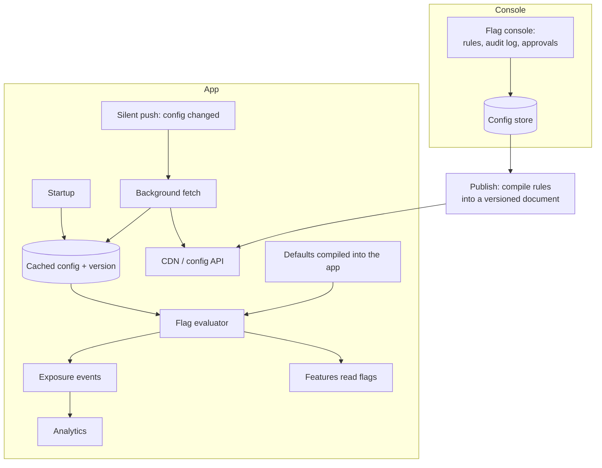
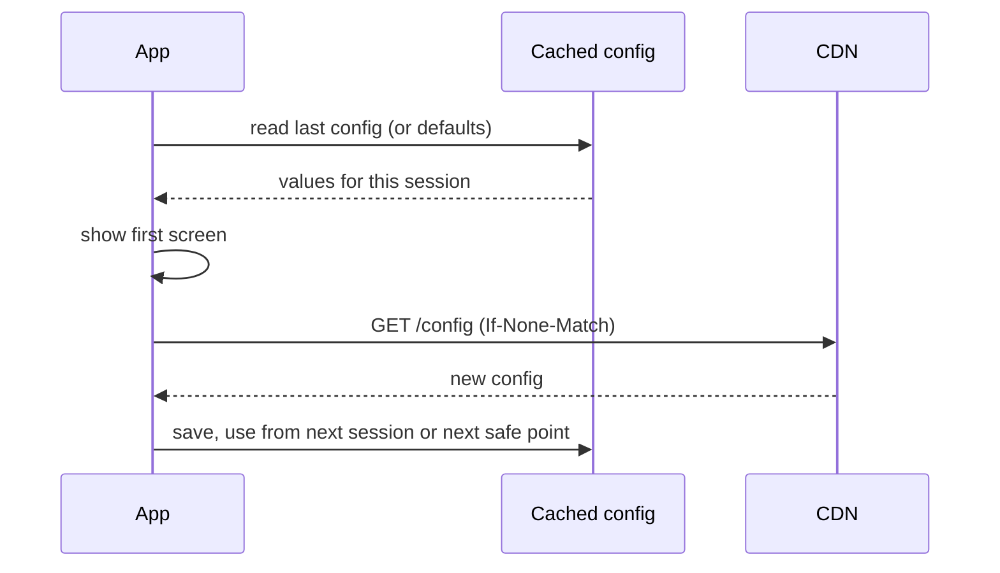
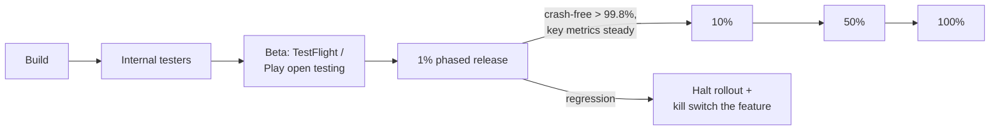

# Design feature flags, remote config and staged rollouts

> A mobile release can't be rolled back: once a version is on a phone, it stays until the user updates. Design the system that lets a team ship safely anyway: feature flags, remote config, kill switches, staged rollouts, experiments and forced updates.

**Difficulty:** 🟡 Mid to 🔴 Senior · **Core topics:** configuration delivery, caching and defaults, targeting, experimentation, release engineering

## Requirements

**Functional**

1. Turn features on or off per user segment without a release (app version, platform, country, percentage of users, internal testers).
2. Change values remotely: limits, copy, timeouts, polling intervals.
3. A kill switch that disables a broken feature within minutes.
4. A/B experiments with stable assignment and exposure logging.
5. Force or suggest an update when a version must stop being used.

**Non-functional**

| Requirement | Target |
|---|---|
| Startup | Config never blocks the first screen |
| Consistency | A flag doesn't flip in the middle of a user's session or flow |
| Propagation | A kill switch reaches most active users within 5 minutes |
| Safety | A bad config can't crash the app or lock users out |
| Offline | The app works with the last known config, or with built-in defaults |

## Estimates

- A config document with 300 flags and values is about **20 KB**, 5 KB gzipped. Fetching it on each launch is cheap.
- 10 million daily users opening the app 5 times: **50 million fetches a day**. Served from a CDN with short caching and ETags, most return `304 Not Modified` with no body.

## Architecture



**Server-side or client-side evaluation?**

| | Server evaluates, sends results | Client evaluates rules |
|---|---|---|
| Payload | Only this user's values: small, private | All rules: larger, and visible to anyone who inspects the app |
| Offline | Last results only | Can re-evaluate when attributes change (for example, after login) |
| Secrecy | Unreleased features stay hidden | Feature names and rules leak |

Most mobile teams evaluate **on the server** for each user and cache the result on the device. Firebase Remote Config, LaunchDarkly and similar services all support this model.

## Data model

```text
Flag (console)
  key             "checkout.new_flow"
  type            bool | int | string | json
  default         value compiled into the app
  rules           ordered list: { conditions, value | rollout % }
  owner, created_at, expires_at    (flags are temporary; old ones are debt)

Config document (sent to a device)
  version         "2026-10-27T10:15:00Z#418"
  values          { "checkout.new_flow": true, "payments.poll_ms": 1500, ... }
  experiments     { "onboarding_copy": "variant_b" }
  min_version     { "android": "4.12.0", "ios": "4.12.1" }
  ttl_seconds     900
```

## API

```http
GET /v1/config
  X-App-Version: 4.13.2   X-Platform: android   X-User-Id: (if logged in)
  If-None-Match: "418"
→ 304 Not Modified
→ 200 { "version": "...#419", "values": {...}, "min_version": {...}, "ttl_seconds": 900 }
```

## Deep dives

### 1. Loading config without slowing startup



- **Never wait for the network on the first screen.** Use the cached config, or the defaults compiled into the app on a first install.
- **Activate new values at safe points:** next cold start, or when the user returns to the home screen. Not in the middle of checkout.
- A **kill switch** is the exception: it's checked when the user enters the feature, so it applies at the next entry.

### 2. Safe defaults and bad configs

- Every flag has a **default in code** that is the safe behaviour (usually "off"). If the config is missing, corrupt or the wrong type, the default wins.
- Parse each value independently: one bad value doesn't discard the whole document.
- Treat config as code: **reviews, approvals and an audit log** for changes, and a one-click revert to the previous version.
- Remote values have **limits in code**. If someone sets `payments.poll_ms` to 1, the app clamps it to a sane minimum.

### 3. Percentage rollouts and experiments

- Assign buckets with a **hash of (flag key + user ID) mod 100**. The same user always gets the same answer, and different flags get independent buckets.
- Before login, use a stable install ID, and decide what happens at login (keep the install bucket or switch to the user's).
- Log an **exposure event** when the user actually sees the feature, not when the flag is read. Otherwise the experiment includes people who never reached the screen.

### 4. Staged rollouts of the app itself



- Play Console staged rollouts and App Store phased releases let you **pause** a release. They don't remove a version already installed.
- Ship **new code dark**: in the binary, behind a flag that's off. Turn it on separately from the release, gradually, and turn it off without a release.
- Watch crash-free users, ANRs, and the business metrics of the flows you touched, broken down by app version.

### 5. Forcing updates

- `min_version` per platform in the config. Below it, the app shows a **blocking** "Please update" screen.
- A softer `recommended_version` shows a dismissible prompt.
- The check must work even when the rest of the app is broken. Keep it in the earliest startup code, with almost no dependencies. Android's in-app updates API and a link to the store cover the update itself.
- Use force updates rarely: security fixes, a broken payment flow, an API you have to retire.

## Failure modes

| What happens | Result |
|---|---|
| Config service down | Apps use cached config or defaults; nothing breaks |
| Someone publishes a broken value | Type check fails for that key; default used; alert fires on parse errors |
| A flag flips while a user is in checkout | New value applies at the next safe point |
| A feature crashes in production | Kill switch turned off; most active users get it within minutes through the next fetch or a silent push |
| Bad release at 1% | Phased release halted; flag turned off for that version |
| Forced update screen has a bug | Can't happen silently: the check is minimal code with its own tests |

## Trade-offs

- **Build vs buy:** Firebase Remote Config and LaunchDarkly cover most needs. Build your own when you need data residency, deep integration with your own experimentation platform, or costs at very large scale.
- **Fresh vs stable:** fetching more often makes kill switches faster but means more requests and more chances for values to change mid-session.
- **Flags everywhere vs code complexity:** flags make releases safe but every flag is a branch to test. Give each flag an owner and an expiry date, and delete it after full rollout.
- **Client vs server evaluation:** see the table above. Server evaluation is the safer default for mobile.

## Interview follow-ups

- **How do you test all the flag combinations?** You don't. Test each flag on and off in isolation for the code it touches, and run end-to-end tests with the configuration production actually uses.
- **How do you roll out a backend change that needs a new app version?** Make the API change additive, ship the app with the new code behind a flag, wait until enough users have that version, then turn the flag on.
- **How would a server-driven UI fit in?** The config tells the app which modules to show and in what order, from a set of components already in the binary. That's safer than shipping arbitrary layouts.

Related: [UPI payments app](upi-payments-app.md) (tuning polling at peak) · [Framework: cross-cutting concerns](../framework.md#6-cross-cutting-concerns)
