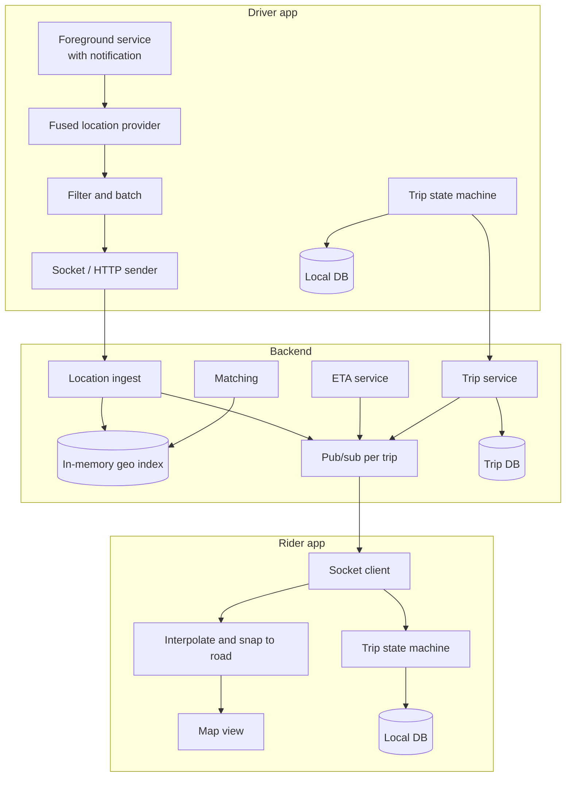
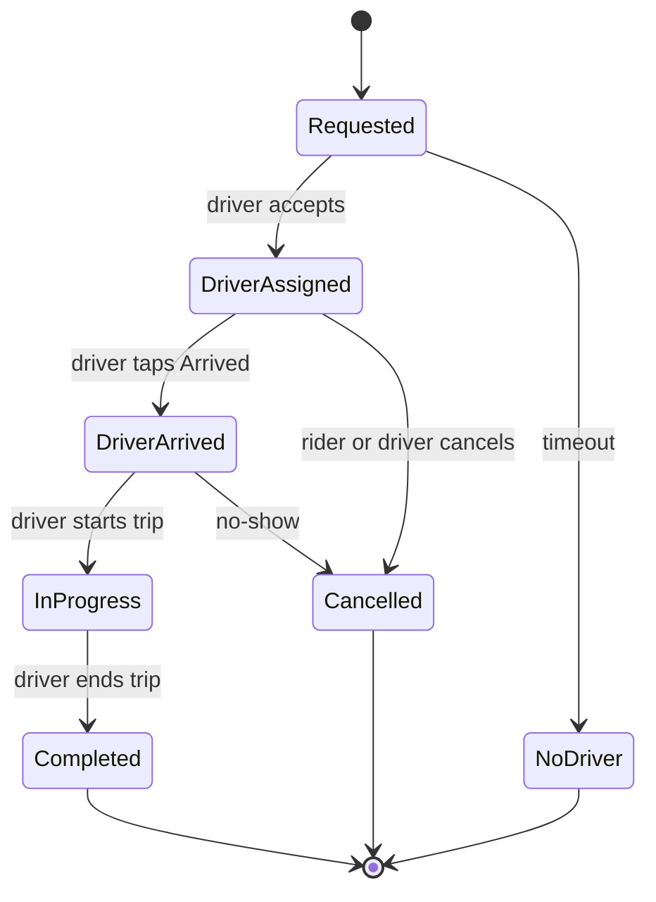
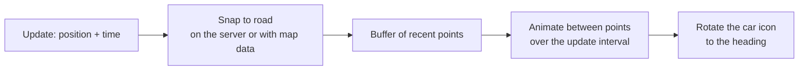

# Design live ride tracking

> Design the rider and driver apps of a ride-hailing service, focusing on the trip itself: the rider books, a driver accepts, and the rider watches the driver arrive on a map and follows the trip until drop-off.

**Difficulty:** 🔴 Senior · **Core topics:** location updates, real-time streams, trip state machines, battery, map rendering

## Requirements

**Functional**

1. The rider requests a ride and sees "finding a driver", then the assigned driver.
2. The rider sees the driver's car moving on the map, with an ETA, until pickup and during the trip.
3. The driver app sends its location while online and handles accept, arrived, start and end trip.
4. Both apps survive the app being backgrounded or killed mid-trip.

**Out of scope:** matching and pricing algorithms, payments (see [UPI payments app](upi-payments-app.md)), ratings.

**Non-functional**

| Requirement | Target |
|---|---|
| Freshness | The car on the rider's map is at most 5 seconds behind |
| Smoothness | The car glides along the road, never teleports or drives through buildings |
| Battery | A driver can work a 10-hour shift; the rider app costs little while waiting |
| Reliability | Trip state is always correct, even after a crash, on both apps |
| Networks | Works on patchy 3G/4G, including tunnels and dead zones |

## Estimates

- 200,000 drivers online at peak, each sending a location every 4 seconds: **50,000 updates a second**. Each update is about 50 bytes in protobuf, so 2.5 MB/s in total. The volume is in the number of writes, not the bytes.
- A driver's phone sends 9,000 updates over a 10-hour shift: about **450 KB** of upload. Trivial for data, but every radio wake-up costs battery, so batch when you can.
- A rider watching a trip receives one update every 2–4 seconds: tiny.

## Architecture



- **Location and trip state are separate streams.** Locations are frequent and disposable: losing one doesn't matter. Trip state changes are rare and must never be lost.
- **Live locations live in memory** (a geo index such as Redis geospatial sets or an H3 grid), not in the main database.
- The rider only subscribes to **one driver's stream, for one trip**.

## Data model

```text
Trip (both apps, local DB and server)
  id, status, rider_id, driver_id, pickup, dropoff,
  status_version     increases with every change
  updated_at

LocationUpdate (in flight only)
  driver_id, trip_id?, lat, lng, accuracy_m, heading, speed_mps,
  recorded_at (device time), seq
```

## API

```text
Driver → server (WebSocket, protobuf, or HTTP batch when the socket is down)
  location  { seq, points: [ {lat, lng, accuracy, heading, speed, t} ] }
  trip_event { trip_id, event: arrived | started | ended, idempotency_key }

Server → rider (WebSocket, subscribed to trip_id)
  driver_location { lat, lng, heading, t, eta_seconds }
  trip_status     { status, status_version, driver {...} }

REST (source of truth for state)
  GET  /v1/trips/{id}
  POST /v1/trips                      (request a ride, idempotency key)
  POST /v1/trips/{id}/events          (driver events, idempotency key)
```

## Deep dives

### 1. The trip state machine



- **The server owns the state.** Apps send events (with idempotency keys) and render the state the server returns.
- Every change has a **`status_version`**. An app ignores any update with a lower version than the one it has, so out-of-order messages (socket and push arriving together) can't move the trip backwards.
- **On launch, both apps fetch the active trip** with `GET /trips/{id}`. A rider who reopens the app mid-trip lands straight back on the live map.
- Driver events that fail to send go into an **outbox** and are retried. "Trip ended" sent from a tunnel must still arrive.

### 2. Sending the driver's location efficiently

- Use the **fused location provider** (Android) or `CLLocationManager` (iOS) with settings that depend on the driver's state:

| Driver state | Interval | Accuracy |
|---|---|---|
| Offline | Off | — |
| Online, waiting | 10–15 s, or on 50 m moved | Balanced |
| Going to pickup / on trip | 2–4 s | High |

- **Filter** points with poor accuracy (say, over 50 m) and impossible jumps (over 200 km/h).
- When the socket is down, **buffer points** and send them as a batch when it reconnects. Old points still help the server compute distance and the fare, even if the rider's map only needs the latest.
- Android needs a **foreground service** with a visible notification to keep receiving locations in the background; iOS needs the location background mode and "Always" permission. Explain why to drivers before asking.

### 3. Making the car move smoothly on the rider's map

Raw updates every 3 seconds make the car jump. Instead:



- **Render a little in the past** (about one update interval). Then you always have a next point to animate towards, rather than guessing.
- If updates stop, keep the car still and show "Driver's location may be delayed" after about 15 seconds. **Don't extrapolate** for long: guessing wrongly looks worse than pausing.
- Animate with the map SDK's marker animation on the UI thread, and keep the camera stable. Don't re-centre on every update while the user is panning.

### 4. ETA

- ETA comes from the server (it knows traffic), sent with location updates.
- Smooth what the user sees: don't let "4 min" flip to "6 min" and back on every update. Change it only when the difference persists.

### 5. Battery and data on the rider app

- Subscribe to driver updates **only while the trip screen is visible**. In the background, rely on push notifications for state changes ("Your driver has arrived").
- On Android, show an ongoing notification; on iOS, a **Live Activity** shows the ETA on the lock screen without the app running.

## Failure modes

| What happens | Driver app | Rider app |
|---|---|---|
| Driver in a tunnel for 2 minutes | Buffers points; events go to the outbox | Car stops; "location may be delayed" |
| Rider app killed mid-trip | — | Reopen: fetch the active trip, resume the live map |
| Driver app killed by the OS | Foreground service makes this rare; on restart, fetch the active trip and resume tracking | Location stale; trip state unaffected |
| Socket messages arrive out of order | — | Lower `status_version` updates ignored |
| "End trip" tapped with no network | Outbox retries with the same idempotency key; UI shows "Ending trip…" | Sees "Completed" once the server receives it |
| Phone GPS returns a wild point | Filtered by accuracy and speed limits | Never sees it |

## Trade-offs

- **Update frequency vs battery and server load:** every second looks great but multiplies cost. Every 3–4 seconds with interpolation looks almost the same.
- **WebSocket vs MQTT vs HTTP polling:** WebSocket is simple and fine for riders. MQTT handles flaky mobile links and many small messages well, which suits driver location. HTTP batching is the fallback for both.
- **Snapping on the server vs on the device:** the server has better map data and the same answer for everyone; the device saves a round trip. Snap on the server, interpolate on the device.
- **Separate driver and rider apps vs one app:** separate apps keep the driver app's permissions and battery profile away from riders. Almost every ride-hailing company ships two.

## Interview follow-ups

- **How do you show nearby cars before booking?** A cheap, cached query of the geo index by map area, refreshed every 10–15 seconds, with fuzzed positions for driver privacy.
- **How does the rider share the trip with family?** A share link to a web page that subscribes to the same trip stream with a limited, expiring token.
- **How would you test this?** Replay recorded GPS traces (including tunnels and bad accuracy) through the driver app's location layer, and drive the state machine with a fake server that delays and reorders messages.

Related: [Building blocks: real-time updates](../building-blocks.md#real-time-updates) · [Building blocks: background execution](../building-blocks.md#background-execution)
