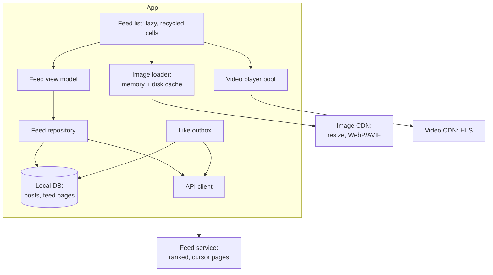
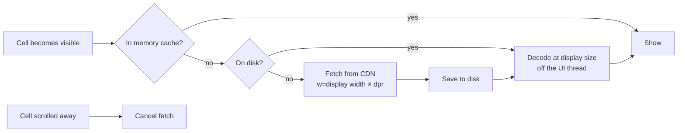
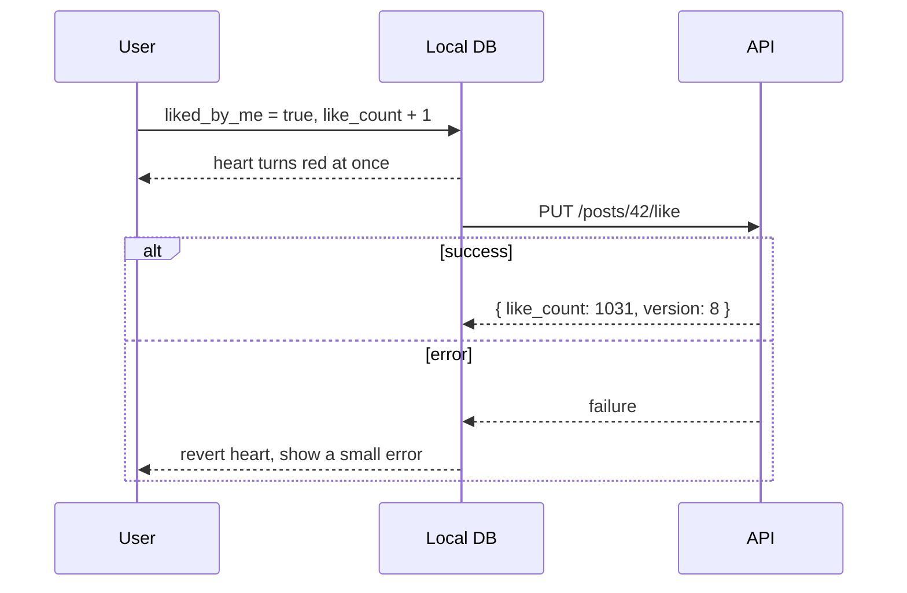

# Design an infinite news feed

> Design the home feed of a social app: an endless list of posts with text, images and short videos, with likes and comments. It should feel instant and scroll smoothly on low-end phones.

**Difficulty:** 🟢 Junior to 🟡 Mid · **Core topics:** cursor pagination, caching, images and video, list performance, optimistic updates

## Requirements

**Functional**

1. Scroll an endless, ranked feed of posts (text, up to 10 images, or a short video).
2. Like a post and see the count change immediately.
3. Pull to refresh; see that new posts are available without losing your place.
4. Open a post's comments.

**Out of scope:** creating posts, the ranking algorithm, ads.

**Non-functional**

| Requirement | Target |
|---|---|
| Time to first content | Under 1 second on a cold start, from cache |
| Scrolling | No dropped frames at 60 Hz on a 2 GB RAM Android phone |
| Data use | Under 10 MB for 5 minutes of scrolling on mobile data |
| Offline | The last feed is readable offline, with images |

## Estimates

- A post's JSON is about 1.5 KB. A page of 20 is **30 KB** (gzipped about 8 KB).
- An image at feed size (1080 px wide, WebP) is 80–150 KB. 20 posts with an average of 1.5 images is about **4 MB a page**. Images are the cost; the JSON isn't.
- Decoded, a 1080 × 1350 image is 1080 × 1350 × 4 bytes = **5.8 MB of memory**. Ten of those in memory and a low-end phone is in trouble, so decode at display size and limit the memory cache by bytes.

## Architecture



## Data model

```text
Post
  id, author {id, name, avatar_url}, text, created_at,
  media [ {type, url, width, height, blurhash, duration_ms?} ],
  like_count, comment_count, liked_by_me, version

FeedPage
  feed_id ("home"), position, post_id, cursor_after
```

Posts and their position in the feed are stored separately. The same post can appear in the home feed, a profile and search; there's one row for it, so a like updates everywhere.

## API

```http
GET /v1/feed/home?after=<cursor>&limit=20
→ { "posts": [...], "next_cursor": "eyJ0IjoxNzMw...", "has_more": true }

GET /v1/feed/home/new-count?before=<first_cursor>
→ { "count": 12 }

PUT    /v1/posts/{id}/like     (idempotent)
DELETE /v1/posts/{id}/like
```

`PUT` and `DELETE` for likes are naturally idempotent: liking twice is still one like.

## Deep dives

### 1. Pagination and prefetching

- **Cursor pagination.** The ranked feed changes all the time, so offsets would show duplicates and skip posts.
- Load the next page when the user is about **5 posts from the end**, so it arrives before they get there.
- **Pull to refresh doesn't replace the list under the user's thumb.** Fetch the new top, show a "12 new posts" pill, and insert only when they tap it or are already at the top.
- **Cold start:** show the cached feed instantly, then fetch a fresh first page. If the cache is older than a few hours, start at the fresh page instead of mixing old and new.

### 2. Images



- Request the right size from the CDN: `?w=412&dpr=2.6&fmt=webp`. The server knows the image's aspect ratio, so the cell has its **final size before the image loads**: no layout jumps.
- Show a **blurhash** placeholder decoded from the post JSON.
- Prefetch images for the next few posts, **on Wi-Fi more eagerly than on mobile data**.
- Memory cache limited by **bytes**, not count, and cleared when the OS reports memory pressure.

### 3. Video

- One player pool of 2 or 3 players, reused by cells. Creating a player per cell runs out of decoders and memory.
- Autoplay **muted** the video that's more than 50% visible and centred; pause the rest.
- Use **HLS or DASH** with adaptive bitrate. Start at a low rendition for a fast first frame.
- Preload only the first second of the next video, and only on Wi-Fi or if the user allowed it.

### 4. Smooth scrolling

- Lazy, recycling lists (`ListView.builder`, `RecyclerView`, `LazyColumn`, `UICollectionView`) with **stable keys** (the post ID).
- Keep cells cheap: no layout passes that depend on loaded content, no work in `build` or `onBind` beyond binding data.
- Parse JSON off the UI thread for large pages.
- Measure on the cheapest phone you support, in profile or release mode, not on a flagship in debug.

### 5. Optimistic likes



Likes are low-risk, so the UI changes instantly. If the user taps like, unlike, like quickly, only send the **final state** after a short debounce.

## Failure modes

| What happens | Result |
|---|---|
| Offline at launch | Cached feed with images from the disk cache; a banner says you're offline |
| Next page fails | A "Retry" row at the end of the list, not a full-screen error |
| A post was deleted after it was cached | Server omits it on refresh; a tap on a stale one shows "This post is no longer available" |
| Low memory | Memory image cache cleared; images reload from disk as you scroll |
| Like fails | Heart reverts with a short message |

## Trade-offs

- **Prefetch more vs save data:** prefetching makes scrolling feel instant but costs data and battery for posts never seen. Tie the amount to the network type and the user's data-saver setting.
- **Cache the whole feed vs only the first page:** caching more allows longer offline reading but shows staler content. Most apps keep a few pages.
- **Server-driven layout vs fixed cells:** server-driven UI lets you ship new post types without an app release but is harder to make fast and test. Use it for some modules, not every cell.
- **Exact counts vs approximate:** "1.2K likes" can be cached longer than an exact count, which lightens the load on the server.

## Interview follow-ups

- **How do you track which posts were seen, for ranking?** Record impressions when a post is at least 50% visible for 1 second, batch them locally and upload every 30 seconds or when the app goes to the background.
- **How would you add ads?** Ads come from a separate service and are inserted at positions the feed response marks, so a slow ad server never delays the feed.
- **How do you make the first launch fast with no cache?** Ship a small first page in the response to the login or config call, lazy-load everything below the fold, and make sure the first frame doesn't wait for analytics or remote config.

Related: [Building blocks: images](../building-blocks.md#images) · [Building blocks: pagination](../building-blocks.md#pagination)
