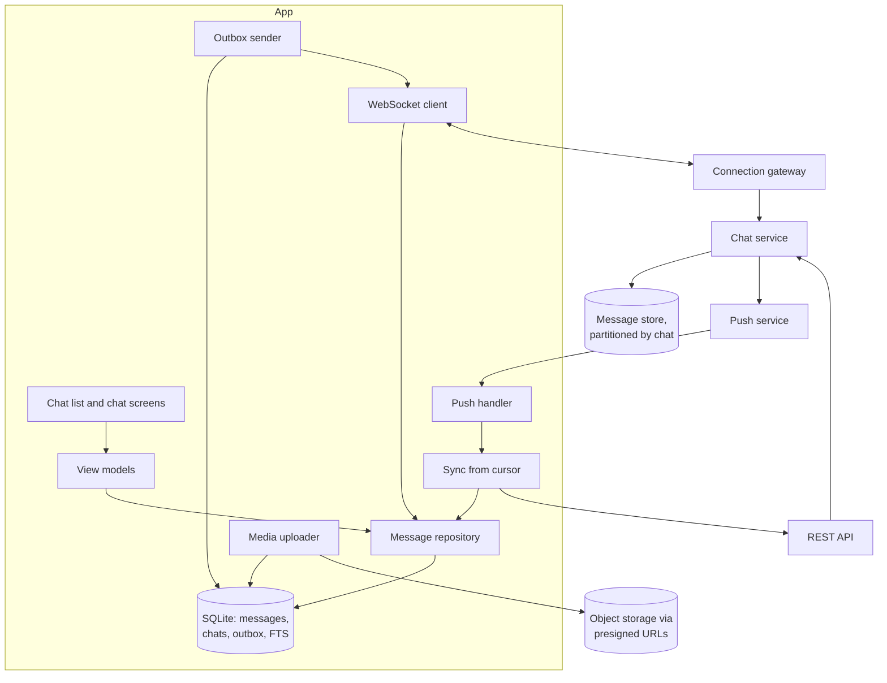
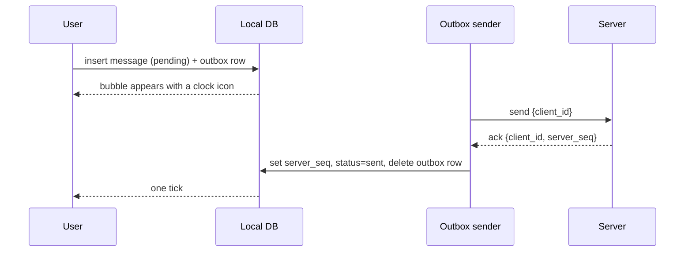
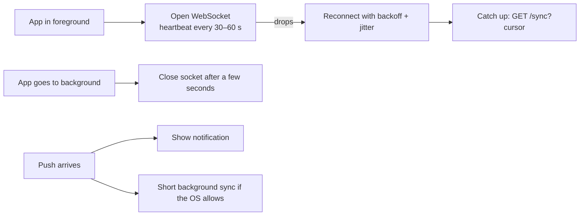

# Design an offline-first chat app

> Design a messaging app with one-to-one and group chats. Messages must send reliably on bad networks, appear in the right order, and show sent, delivered and read ticks.

**Difficulty:** 🟡 Mid to 🔴 Senior · **Core topics:** outbox, ordering, real-time delivery, receipts, media upload, local search

## Requirements

**Functional**

1. Send and receive text messages in one-to-one and group chats (up to 256 members).
2. Send photos and documents.
3. Show sent, delivered and read status.
4. Read and write while offline; messages send when the network returns.
5. A chat list with unread counts, and search across messages.

**Out of scope:** voice and video calls, end-to-end encryption details (mention it, don't design it), stories.

**Non-functional**

| Requirement | Target |
|---|---|
| Reliability | A message the user sent is never lost or sent twice |
| Ordering | Everyone in a chat sees messages in the same order |
| Latency | Under 500 ms end to end when both people are online |
| Startup | The chat list appears instantly, from the local database |
| Battery and data | No polling in the background; images compressed before upload |

## Estimates

- 50 million daily users, 40 messages sent each: **2 billion messages a day**, about 23,000 a second on average.
- A text message is about 200 bytes with metadata. A user with 100,000 messages has **20 MB** of local data: fine for SQLite with an FTS index for search.
- Photos: compress to about 200 KB at 1600 px. Keep thumbnails (10 KB) in the database, download full images on demand.

## Architecture



- **Sending and receiving are separate paths.** The outbox sends; the socket and sync paths receive. Neither blocks the other.
- **The socket is only for the foreground.** In the background, a push notification wakes the app and it syncs over HTTP.
- **Media goes straight to object storage** with a presigned URL. The message only carries the media key.

## Data model

```text
Message
  client_id    UUID v7 from the sender (idempotency + temporary order)
  server_seq   per-chat sequence assigned by the server (null until acknowledged)
  chat_id, sender_id
  body, media_key, media_local_path, thumbnail_blob
  status       pending | sent | delivered | read | failed
  created_at   sender's clock (display only)
  unique (chat_id, client_id)

Chat
  id, title, last_message_preview, unread_count,
  last_synced_seq, last_read_seq, muted_until
```

**`server_seq` is the order.** Client clocks are wrong too often to sort by. Until a message has a `server_seq`, it sorts at the bottom of the chat after every acknowledged message, in `client_id` order.

## API

```text
WebSocket frames (JSON or protobuf)
  → send     { client_id, chat_id, body, media_key? }
  ← ack      { client_id, chat_id, server_seq, server_time }
  ← message  { chat_id, server_seq, client_id, sender_id, body, ... }
  → receipt  { chat_id, up_to_seq, kind: delivered | read }
  ← receipt  { chat_id, user_id, up_to_seq, kind }

REST
  GET  /v1/chats/{id}/messages?after_seq=1203&limit=200   # gap fill and catch-up
  GET  /v1/sync?cursor=...                                  # changed chats since cursor
  POST /v1/media/upload-url                                 # presigned upload
```

Receipts are **"up to sequence N"**, not one per message. Reading 50 messages sends one receipt.

## Deep dives

### 1. Sending reliably: the outbox



- The server deduplicates on `(chat_id, client_id)`. If the ack is lost and the client re-sends, the server returns the same `server_seq`.
- Send **in order per chat**, one in flight at a time per chat (or a small window). This keeps a user's own messages in the order they typed them.
- A message stays `pending` (clock icon) until acknowledged. After a long time or a permanent error (blocked by the recipient, chat deleted) it becomes `failed` with a "Tap to retry" action.

### 2. Receiving and ordering

- Every incoming message has a `server_seq`. The client stores `last_synced_seq` per chat.
- If a message arrives with `server_seq` greater than `last_synced_seq + 1`, there's a **gap**. Fetch `after_seq=last_synced_seq` before (or while) showing the new one.
- Insert is an **upsert on `(chat_id, client_id)`**. The same message from the socket, a push and a sync becomes one row. This also turns your own pending message into the acknowledged one when it comes back.

### 3. Staying connected without draining the battery



- **Push carries a preview and the chat ID**, enough to show a notification. When the user opens the chat, the app syncs properly.
- Use **collapsible pushes** per chat, so 30 messages in a busy group produce one updated notification.
- After reconnecting, always **catch up from the cursor** before trusting the socket again.

### 4. Media

1. Compress and resize on the device, in a background isolate or thread.
2. Insert the message immediately with `media_local_path` and a thumbnail, so the bubble shows the photo at once.
3. Upload to a presigned URL (resumable for large files; see [resumable video upload](resumable-video-upload.md)).
4. Then send the message with the `media_key`.

Recipients get the thumbnail inline and download the full image when the bubble is visible. Auto-download rules depend on Wi-Fi or mobile data, as set by the user.

### 5. Local search

SQLite **FTS5** on message bodies, filled from the same transaction that inserts messages. Search works offline, instantly, across everything on the device. Messages older than the local retention window are searched on the server, and the UI says so ("Search older messages").

## Failure modes

| What happens | Result |
|---|---|
| Send while offline | Bubble with a clock icon; sends when the network returns, even if the app was closed (WorkManager / background task) |
| Ack lost, client re-sends | Server returns the same `server_seq`; one message |
| Socket drops for 10 minutes | Reconnect, sync from the cursor, gaps filled; nothing missed |
| Push dropped by the OS | Message appears when the app next syncs |
| Two devices for the same user | Both receive messages from sync; read receipts from either update both |
| Phone clock wrong by a day | Order is still correct, because it's based on `server_seq`; displayed time uses `server_time` once acknowledged |
| Group with 256 members all reading | Read receipts are "up to N" per member, aggregated before being sent to the sender |

## Trade-offs

- **WebSocket vs polling vs push only:** sockets give the best latency in the foreground; push is essential in the background; polling is a fallback for networks that block sockets.
- **Server sequence vs client timestamps:** a server sequence per chat costs a little coordination on the server but makes ordering correct and gaps detectable.
- **Keep everything locally vs a window:** keeping everything makes search and scrolling instant; a window (say, 1 year) bounds storage. Most apps keep text forever and expire media.
- **End-to-end encryption:** the server can no longer read messages, which rules out server-side search and moderation of content, and makes multi-device sync and backups much harder. Mention the Signal protocol and move on unless asked.

## Interview follow-ups

- **How do you show "typing…"?** Ephemeral socket events, not stored, throttled to one every few seconds, expiring after about 5 seconds without a refresh.
- **How do you edit or delete a message?** An edit is a new event that refers to the original `client_id`, with its own `server_seq`, so it syncs like any other message.
- **How do you scroll a chat with 100,000 messages smoothly?** Page from the database by `server_seq`, keep only nearby pages in memory, and keep a stable item key so the list doesn't jump when older pages load.
- **How would you migrate the local database schema?** Versioned migrations tested against real old databases. Never require a full re-download.

Related: [Building blocks: real-time updates](../building-blocks.md#real-time-updates)
