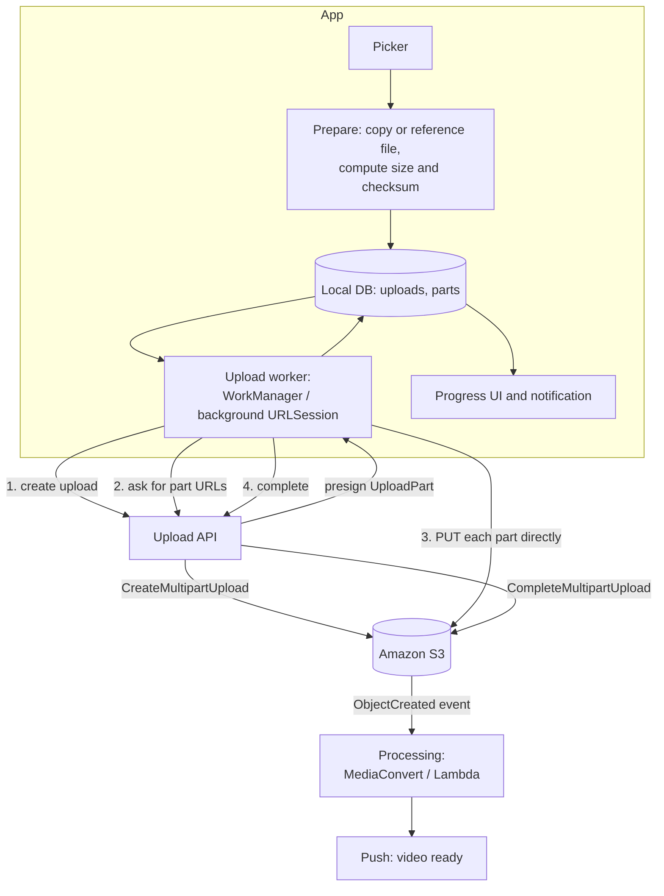
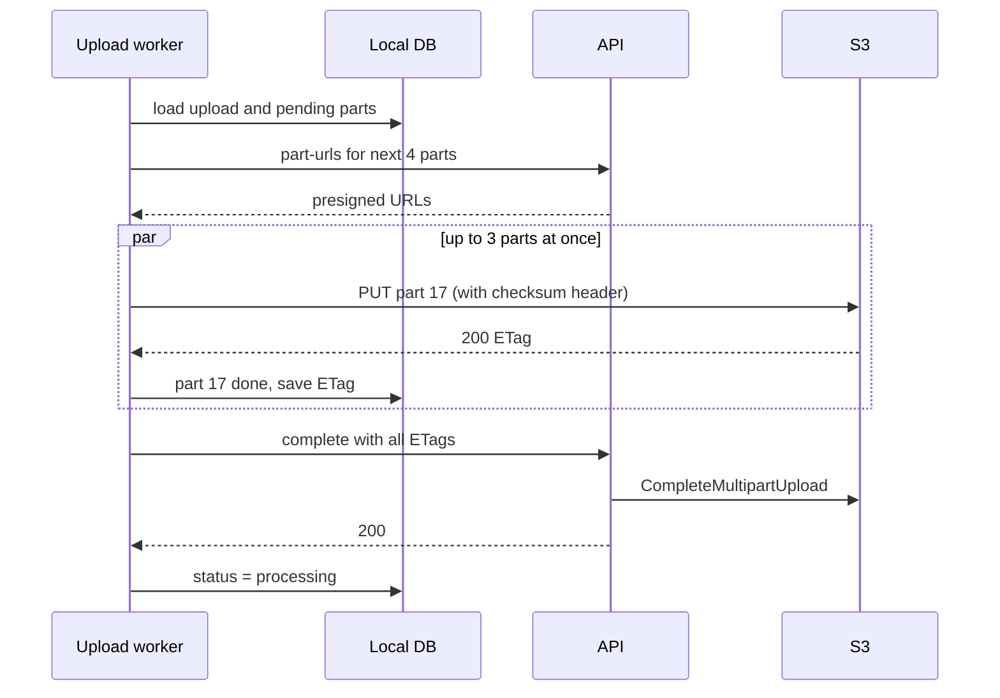

# Design resumable video uploads

> Design how a mobile app uploads large videos (100 MB to 4 GB) on unreliable networks. Uploads must survive network drops, app restarts and the app being in the background, and must never start over from zero.

**Difficulty:** 🟡 Mid to 🔴 Senior · **Core topics:** S3 multipart upload, presigned URLs, background transfers, checksums, progress

## Requirements

**Functional**

1. The user picks one or more videos and adds a title; the upload starts at once.
2. Progress is shown per video, also in a notification.
3. Uploads continue in the background and resume after a network drop, an app kill or a reboot.
4. The user can pause, resume and cancel.
5. Once uploaded, the server processes the video (transcoding, thumbnails) and the app shows when it's ready.

**Non-functional**

| Requirement | Target |
|---|---|
| Resumability | After any interruption, lose at most one part's worth of progress |
| Integrity | The file on the server is byte-for-byte what was on the phone |
| Security | The app never holds cloud credentials; uploads are scoped to one file |
| Cost | No upload traffic through our API servers |
| Data | Respect "upload on Wi-Fi only" |

## Estimates

- A 2 GB video on a 5 Mbps uplink takes **about 55 minutes**. Interruptions during an upload that long are certain, not an edge case.
- With 8 MB parts, a 2 GB file is **256 parts**. Losing one part on a drop costs at most 8 MB.
- S3 multipart limits: parts of **at least 5 MB** (except the last) and **at most 10,000 parts**. For a 4 GB file, 8 MB parts give 512 parts: well within limits.

## Architecture



- **Our API never touches the bytes.** It creates the multipart upload, signs short-lived URLs for individual parts, and completes the upload. The phone sends parts **straight to S3**.
- **The local database is the upload's memory.** Every part's state is recorded, so any process restart can continue.
- Processing starts from an **S3 event**, not from the client saying "done", so a client that disappears after the last part doesn't leave a video unprocessed.

## Data model

```text
Upload
  id                 client UUID (idempotency key for create)
  local_uri          file path or content URI
  size_bytes, checksum_sha256 (whole file)
  part_size          8 MB
  s3_upload_id, object_key        from the server
  status             queued | uploading | paused | completing | processing | ready | failed | cancelled
  wifi_only          bool

UploadPart
  upload_id, part_number (1..N), offset, length,
  checksum_crc32     base64, computed before sending
  etag               from S3 once uploaded
  status             pending | in_flight | done
```

## API

```http
POST /v1/uploads                      Idempotency-Key: <upload id>
{ "size_bytes": 2147483648, "content_type": "video/mp4", "part_size": 8388608 }
→ { "upload_id": "...", "object_key": "u/42/7f9c.mp4", "s3_upload_id": "..." }

POST /v1/uploads/{id}/part-urls
{ "part_numbers": [17, 18, 19, 20] }
→ { "urls": { "17": "https://bucket.s3...&partNumber=17&uploadId=...&X-Amz-Signature=...", ... },
    "expires_in": 900 }

GET  /v1/uploads/{id}/parts           # server lists parts S3 already has (ListParts)
POST /v1/uploads/{id}/complete
{ "parts": [ { "part_number": 1, "etag": "\"a54357...\"" }, ... ] }
DELETE /v1/uploads/{id}               # AbortMultipartUpload
```

Presigned URLs are requested **a few at a time** and expire in minutes. A leaked URL lets someone upload one part of one file, nothing more.

## Deep dives

### 1. The upload loop



- **Concurrency of 2 or 3 parts.** More doesn't help on a phone's uplink and makes every drop more expensive.
- Each part is read from the file at `offset` with `length`, **streamed**, never loaded whole into memory.
- **Checksums:** send each part with a CRC32 (or SHA-256) checksum header. S3 rejects a corrupted part instead of storing it.
- When a presigned URL has expired (`403`), ask for a new one and retry; don't fail the upload.

### 2. Resuming after anything

On every start of the worker:

1. Parts marked `done` with an ETag are skipped.
2. Parts marked `in_flight` are treated as `pending`: we can't know whether S3 received them.
3. If local state is lost or suspicious, call `GET /parts` (S3 `ListParts`) and trust S3's list.
4. If the multipart upload no longer exists (it was aborted by a lifecycle rule), start a new one. Only this case starts from zero.

Re-sending a part is always safe: uploading part 17 again simply replaces it.

### 3. Running in the background

| | Android | iOS |
|---|---|---|
| Mechanism | WorkManager long-running worker with a foreground notification, or a user-initiated data transfer job on Android 14+ | Background `URLSession` with upload tasks from **files** |
| Survives app kill | Yes, WorkManager reschedules | The OS continues transfers already handed to it, then relaunches the app to handle completion |
| Survives reboot | Yes | Pending tasks resume; the app re-enqueues the rest on next launch |
| Network rules | Constraints: unmetered network for Wi-Fi only | `allowsCellularAccess`, `allowsExpensiveNetworkAccess` |

iOS background sessions upload **files, not streams**. So the app writes each part to a temporary file (or a few at a time) before handing it to the session, and deletes it when done. On iOS, the system decides when background transfers run; they may slow down when the battery is low.

### 4. Getting the file safely

- On Android, a video from the photo picker is a **content URI** that may stop being readable after the app restarts. Either take a persistable permission or copy the file into app storage first (and check free space).
- On iOS, `PHPicker` gives a temporary file. Copy it into the app's container before starting.
- **Compress or not?** Re-encoding on the device saves upload time and data but takes minutes and battery. A good default: upload the original on Wi-Fi; offer a smaller version on mobile data.

### 5. Server side, briefly

- An **S3 lifecycle rule** aborts incomplete multipart uploads after a few days, so abandoned uploads don't cost storage forever.
- The object key is chosen by the **server** (`u/{user}/{uuid}.mp4`): the client can't overwrite other people's files.
- For users far from the bucket's region, **S3 Transfer Acceleration** routes uploads through the nearest edge location.
- When the object is created, processing (AWS Elemental MediaConvert or a Lambda pipeline) creates renditions and thumbnails, then a push tells the app it's ready.

## Failure modes

| What happens | Result |
|---|---|
| Network drops at 63% | In-flight parts retried; upload resumes from the last finished part |
| App killed by the OS | WorkManager / background session continues or restarts; progress kept |
| Phone reboots | Worker re-runs on boot (Android) or next launch (iOS); continues from the database |
| Presigned URL expired | 403; request a fresh URL and retry the part |
| Part corrupted in transit | S3 rejects the checksum; part retried |
| User switches to mobile data with Wi-Fi only on | Upload pauses with "Waiting for Wi-Fi" |
| User deletes the video from the gallery mid-upload | Copy in app storage is unaffected; or the upload fails with a clear message if it wasn't copied |
| Upload abandoned for a week | Lifecycle rule aborts it; the app shows "Upload expired, start again" |

## Trade-offs

- **Part size:** small parts lose less on a drop but mean more requests and URL signing. 5–16 MB is the usual range on mobile.
- **S3 multipart vs a resumable protocol like tus:** multipart is native to S3 and needs no extra servers; tus gives one standard protocol across storage back ends but needs a tus server in front.
- **Copying the file first:** safer and simpler to resume, but doubles storage for a while. Check free space first.
- **Parallel parts:** a little parallelism hides latency; too much competes with the user's other traffic and gains nothing on a slow uplink.

## Interview follow-ups

- **How do you show accurate progress?** Bytes from finished parts plus bytes sent in the parts in flight, smoothed over a few seconds. Show the remaining time only after it stabilises.
- **How do you stop someone from uploading 100 GB?** The server sets the size and content type when creating the upload, checks them on completion, and enforces per-user quotas.
- **Could you deduplicate uploads?** Hash the file first. If the server already has that hash for this user, skip the upload.
- **What changes for a web client?** Same API. The browser reads `File.slice()` for each part. There's no background upload, so warn before closing the tab.

Related: [Offline-first chat: media](offline-first-chat.md#4-media) · [Building blocks: background execution](../building-blocks.md#background-execution)
