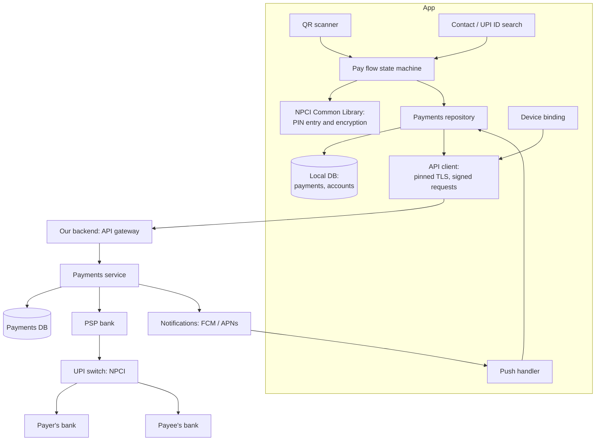
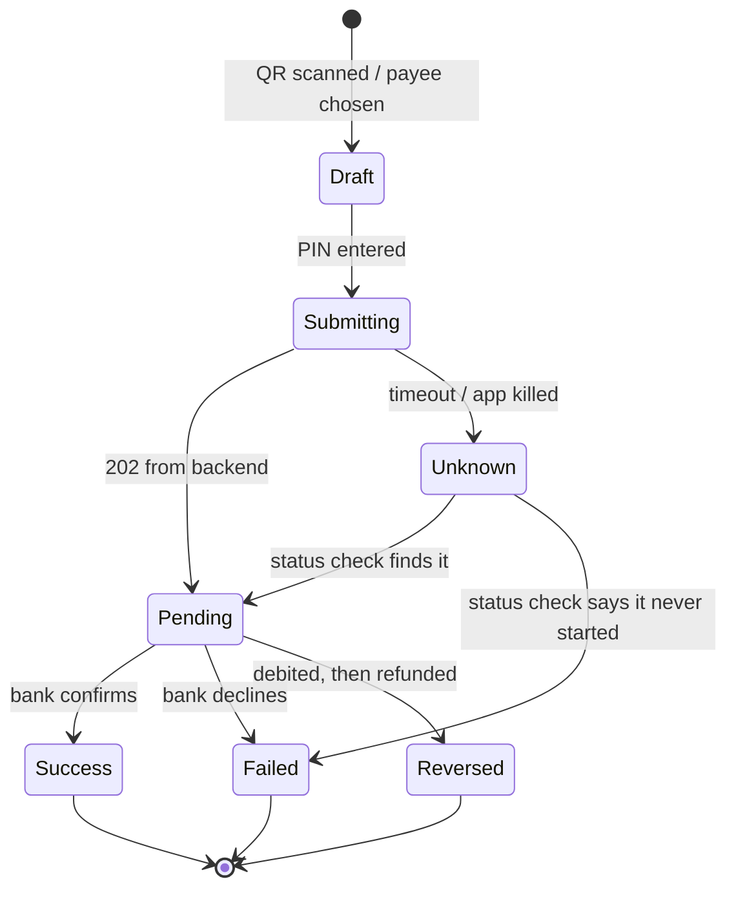
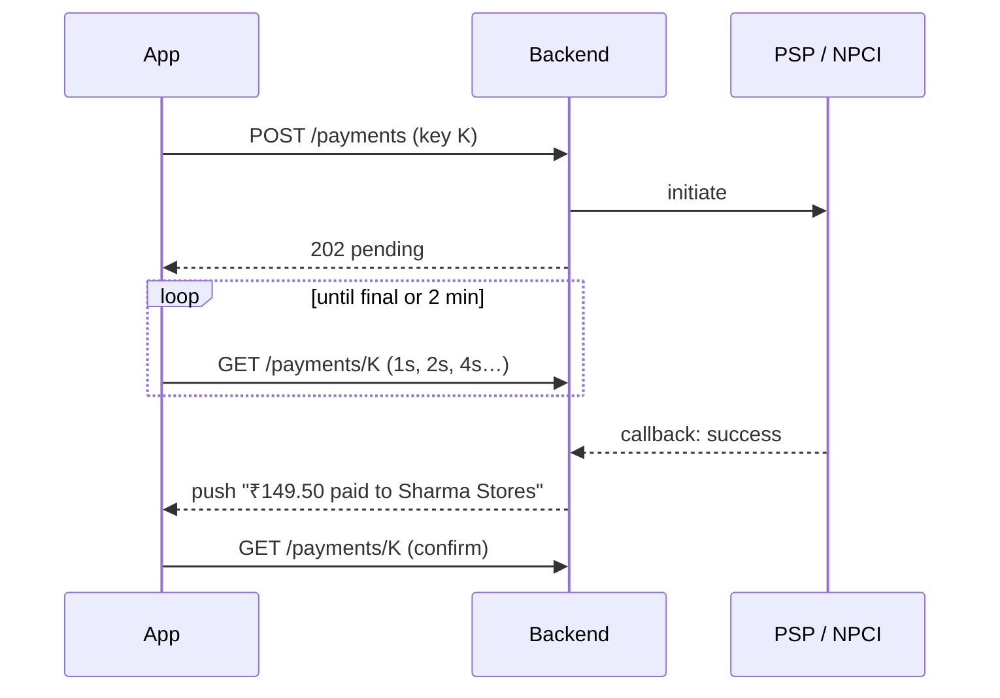

# Design a UPI payments app

> Design the mobile app for a UPI payments service: people link a bank account, pay by scanning a QR code or entering a UPI ID, and see their payment history.

**Difficulty:** 🔴 Senior · **Core topics:** payment state machines, idempotency, reconciliation, device binding, security

## Requirements

**Functional**

1. Onboard: verify the phone number, link a bank account, set or enter the UPI PIN.
2. Pay a merchant by scanning a QR code, or a person by UPI ID, phone number or contact.
3. See the result of every payment, including ones that are still pending.
4. See payment history and receive notifications for money in and out.

**Out of scope:** collect requests, autopay mandates, credit lines, rewards.

**Non-functional**

| Requirement | Target |
|---|---|
| Correctness | Never show "success" for a payment that didn't happen, and never let a double tap pay twice |
| Latency | Scan to "enter PIN" in under 2 seconds; most payments confirmed within 5 seconds |
| Availability | Banks and the UPI switch fail often. The app must explain failures and pending states clearly |
| Security | The PIN never touches our code; the account is bound to this device and SIM |
| Devices | Low-end Android phones on mobile data are the main audience |

## Estimates

- 10 million daily users, 3 payments each, is **30 million payments a day**, about **350 a second** on average and over 2,000 a second at evening peaks and festival sales.
- A history row is about 300 bytes. A heavy user's year of history (2,000 rows) is **600 KB**: keep it all on the device.
- Payments are tiny requests. **Latency and the reliability of downstream banks** matter, not bandwidth.

## Architecture



Key points:

- **We never see the UPI PIN.** PIN entry happens in NPCI's Common Library, which encrypts it on the device. Our app only receives an opaque credential blob to forward.
- **Our backend is the only thing that talks to the bank.** The app asks the backend to start a payment and then asks it for the status. It never decides the outcome itself.
- **The local database holds every payment** the user has made, including pending ones, so the history and the "pending" banner survive app restarts.

## Data model

```text
Payment
  id                 client-generated UUID (idempotency key)
  upi_txn_id         from the backend once the payment is created
  direction          debit | credit
  counterparty_vpa   sharmastores@okicici
  counterparty_name  Sharma Stores
  amount_paise       14950           (integers, never floating point)
  note
  status             draft | submitting | pending | success | failed | reversed
  failure_code       from the bank, mapped to a user message
  created_at, updated_at, server_version

BankAccount
  id, bank_name, masked_number (XXXX1234), ifsc, is_default, pin_set
```

Store money as **integer paise**. Floating point rounding has no place in a payments app.

## API

```http
POST /v1/payments
Idempotency-Key: 7f9c0b1e-…            # the Payment.id, created when the user tapped Pay
{ "payee_vpa": "sharmastores@okicici", "amount_paise": 14950,
  "account_id": "acc_1", "credential": "<encrypted blob from NPCI library>",
  "qr_payload": "upi://pay?..." }
→ 202 { "payment_id": "...", "upi_txn_id": "...", "status": "pending" }

GET /v1/payments/{id}                  # status, safe to poll
GET /v1/payments?after=<cursor>        # history sync
POST /v1/device/bind                   # device binding challenge
```

`POST /payments` returns **202 Accepted**, not the final result: the bank answers asynchronously.

## Deep dives

### 1. The payment state machine

The most important part of the design. Every screen reads the state; only the state machine changes it.



- **`Unknown` is a real state.** If the request timed out, the money may or may not have moved. Show "Checking your payment…", never "Failed", and never let the user pay again until it's resolved.
- **Persist before sending.** Write the payment as `submitting` to the database, then call the API. If the app is killed mid-request, on next launch it finds a `submitting` row and checks the status instead of guessing.
- **Pending can last a long time.** If the payee's bank times out, the payment may stay pending for minutes and occasionally much longer before it completes or is automatically reversed. The UI must say plainly: "Your money is safe. If this payment fails, it will be refunded to your account."

### 2. Idempotency and double taps

Three layers, because each one alone isn't enough:

1. **UI:** disable the Pay button on first tap.
2. **Client:** the idempotency key is the `Payment.id`, created when the payment screen opens. Retries reuse it.
3. **Server:** a unique index on `(user_id, idempotency_key)`. A repeat returns the original payment instead of creating a new one.

A second payment to the same payee for the same amount within a minute gets a confirmation dialog: legitimate, but often a mistake.

### 3. Learning the outcome: push, poll and reconcile



- **Poll** while the result screen is open, with backoff, for about two minutes.
- **Push** for when the app is in the background. A push is a hint: the app always confirms with `GET` before showing success.
- **Reconcile on launch:** sync history from the cursor and re-check every payment still `pending` or `unknown`.

### 4. Scanning QR codes

- Scan with the platform barcode API (ML Kit or VisionKit). Scanning must start in under a second.
- A UPI QR code holds either a `upi://pay?...` link or a Bharat QR (EMV) payload. Parse both and **validate before showing the amount screen**: the UPI ID format, the amount, and for EMV codes the CRC. The [upi_kit](https://github.com/ChandraChaan/upi_kit) Dart package does all three.
- If the QR code has a fixed amount (`am`), the payer can't edit it. Show the payee's **verified name from the backend** (looked up from the UPI ID), not just the name inside the QR code, which anyone can print.

### 5. Device binding and security

- **Device binding:** at onboarding the app sends an SMS from the user's SIM to the provider's number (so the phone number really belongs to this SIM), and registers a device key generated in the Keystore or Secure Enclave. Each sensitive request is signed with that key.
- **SIM change or reinstall** breaks the binding and forces onboarding again.
- **Integrity:** Play Integrity or App Attest at login and before payments; refuse rooted or tampered devices or limit what they can do.
- **Screens:** block screenshots and screen recording on the PIN and account screens (`FLAG_SECURE` on Android; hide content when the app goes to the app switcher on iOS).
- **Network:** certificate pinning with a backup pin, and no payment data in logs or analytics.

## Failure modes

| What happens | What the user sees | What the system does |
|---|---|---|
| Network drops after PIN entry | "Checking your payment…" | Row stays `unknown`; status checks with backoff; never re-sends with a new key |
| App killed during payment | On reopen: the pending payment at the top of the home screen | Launch reconciliation checks every non-final payment |
| Payee's bank times out | "Pending. Your money is safe." | Backend waits for the switch's final status; push when it resolves |
| Debited but payment failed | "Failed. ₹149.50 will be refunded to your account." | Track the reversal; status `reversed` when refunded |
| User taps Pay twice | One payment | Same idempotency key; unique index on the server |
| Push never arrives | Correct status next time the app opens | Pushes are hints; status always comes from the API |
| Fake QR code with a misleading name | Verified name from the backend, with a warning if it differs | Name lookup by UPI ID before the PIN screen |

## Trade-offs

- **Optimistic UI vs correctness:** most apps show changes instantly. Payments must not. Show progress immediately, but the result only after the server confirms.
- **Polling cost vs speed:** aggressive polling makes results feel instant but multiplies traffic at peak times. Short backoff for the first seconds, push after that.
- **Strict security vs reach:** blocking rooted devices protects users but excludes some legitimate ones. A middle path is to allow small payments and require extra checks for large ones.
- **Native vs cross-platform:** Flutter or React Native work well for the UI. The NPCI library, device binding and integrity checks are native SDKs behind platform channels.

## Interview follow-ups

- **How would you support paying without internet?** UPI Lite stores a small balance on the device for small payments, and UPI 123PAY works over feature-phone channels. Both change the trust model, so talk about limits and later sync.
- **How do you test this?** Unit-test the state machine for every transition, especially `unknown`. Use a fake backend that can delay, drop and duplicate responses. Run end-to-end tests against the bank's sandbox.
- **How do you show history quickly for a user with 10,000 payments?** Local database with an index on `created_at`, paged queries, sync by cursor.
- **The festival sale is tomorrow. What could go wrong?** Downstream banks slow down, so more payments stay pending. Make sure the pending UI and the status endpoint can take the load, and turn down polling rates with remote config if needed.

Related: [Feature flags and rollouts](feature-flags-and-rollouts.md) · [Building blocks: offline writes](../building-blocks.md#offline-writes-the-outbox)
