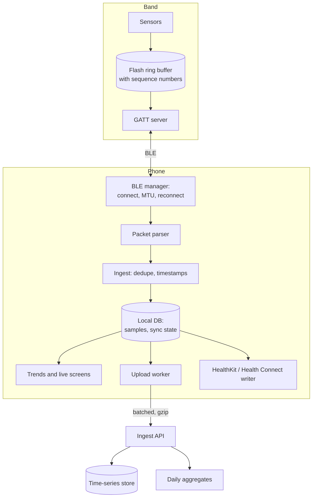
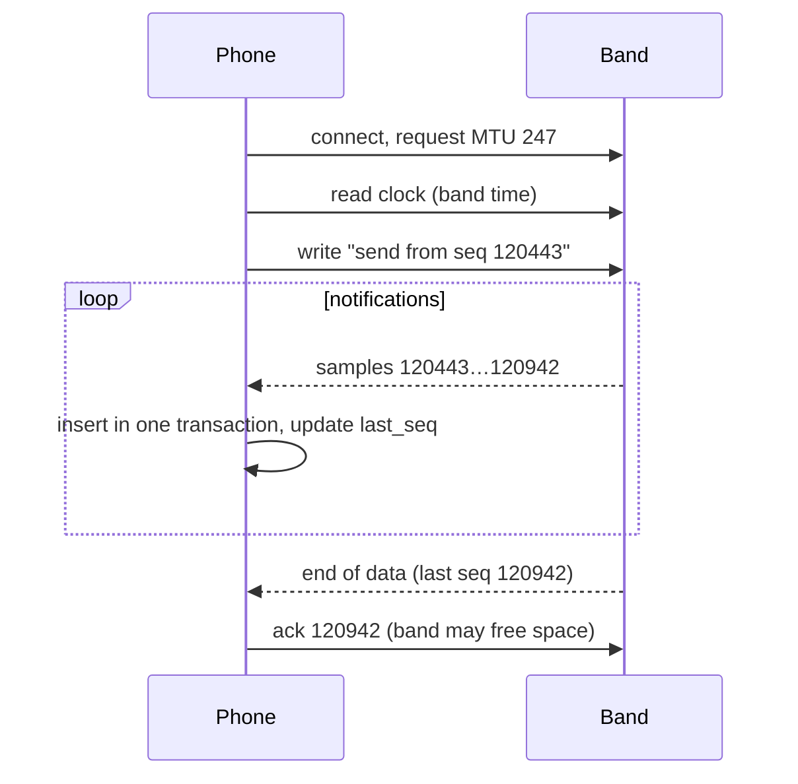

# Design health-data sync from a wearable

> Design the app for a Bluetooth fitness band. The band records heart rate, steps, sleep and SpO2. The phone app collects the data, shows trends and syncs everything to the cloud, and can also read from and write to Apple Health and Health Connect.

**Difficulty:** 🔴 Senior · **Core topics:** Bluetooth LE, background execution, batching, deduplication, time, health-data privacy

## Requirements

**Functional**

1. Pair the band and keep it connected.
2. Show live heart rate during a workout.
3. Collect the band's stored history (it records while away from the phone) and show daily trends.
4. Sync data to our backend, so it survives a new phone and shows on the web dashboard.
5. Optionally write to Apple Health (HealthKit) and Health Connect, and read data from other apps.

**Non-functional**

| Requirement | Target |
|---|---|
| No data loss | Every sample the band recorded must reach the cloud exactly once, even after days offline |
| Battery | The app's background use stays small; the band lasts a week |
| Freshness | Live heart rate under 2 seconds behind; history synced within an hour of being in range |
| Privacy | Health data is sensitive personal data: explicit consent, encryption, deletion on request |
| Platforms | iOS and Android, each with very different background rules |

## Estimates

- Heart rate every second during a workout, every 5 minutes otherwise: about **300 samples an hour** in a mixed day, roughly 7,000 a day including steps and SpO2.
- A sample is about 16 bytes on the band and 60 bytes in the phone's database: **under 0.5 MB a day** per user. A year fits on the phone comfortably.
- Bluetooth LE throughput in practice is roughly 5–100 KB/s depending on the phone, connection interval and MTU. A day of history is a few seconds of transfer **if** you negotiate a larger MTU and use notifications rather than reads.
- 1 million users syncing hourly is about 280 uploads a second, each a small compressed batch.

## Architecture



Three separate pipelines, each with its own checkpoint:

1. **Band → phone:** Bluetooth transfer, checkpointed by the band's sequence number.
2. **Phone → cloud:** upload worker, checkpointed by the last uploaded local row.
3. **Phone → HealthKit / Health Connect:** a separate writer, because those APIs have their own permissions and failure modes.

If one pipeline is stuck (no network, Health permission revoked), the others keep going.

## Data model

```text
Sample
  device_id      the band's ID
  seq            the band's sequence number, increases forever
  type           heart_rate | steps | spo2 | sleep_stage
  value          integer in fixed units (bpm, steps, % × 10)
  recorded_at    UTC instant, corrected for the band's clock drift
  tz_offset_min  the user's offset when it was recorded
  uploaded       bool
  unique (device_id, type, seq)

SyncState
  device_id, last_seq_from_band, last_uploaded_row_id, clock_offset_ms
```

**`(device_id, type, seq)` is the deduplication key everywhere**, on the phone and on the server. Re-reading the band, re-uploading a batch, or two phones syncing the same band all become harmless.

## API

```http
POST /v1/samples:batch
Content-Encoding: gzip
{ "device_id": "band_8F2A", "samples": [ { "type": "heart_rate", "seq": 120443,
  "value": 72, "recorded_at": "2026-10-27T05:31:00Z", "tz_offset_min": 330 }, … ] }
→ 200 { "accepted": 498, "duplicates": 2, "ack_seq": { "heart_rate": 120941 } }

GET /v1/aggregates?type=heart_rate&from=2026-10-01&to=2026-10-27&bucket=day
```

Batches of up to 500 samples, gzip-compressed. The server **upserts on the dedup key** and returns how far it has received, so the client can safely delete or mark rows.

## Deep dives

### 1. Getting data off the band reliably

The band stores samples in a ring buffer with a **monotonic sequence number**. The phone asks for everything after the last sequence it has.



- **Checkpoint after each committed chunk**, not at the end. A dropped connection resumes where it stopped.
- **Tell the band what was received** so it can free space, but only after the phone's database transaction has committed.
- If the band's buffer wraps (the user was away for weeks), the band reports the oldest sequence it still has. Show the gap honestly instead of pretending.
- Parse standard characteristics (Heart Rate Measurement `2A37`, PLX `2A5F`) with a tested parser such as [ble_gatt_parser](https://github.com/ChandraChaan/ble_gatt_parser), and test the whole flow without hardware using a simulator such as [ble_device_simulator](https://github.com/ChandraChaan/ble_device_simulator).

### 2. Time is harder than it looks

- **The band's clock drifts.** At each connection, read the band's time, compare it with the phone's, and store the offset. Correct timestamps during ingest.
- **Store UTC plus the offset at recording time.** A user who flies from Bengaluru to London should see last night's sleep on Indian time.
- **Bucket aggregates in the user's local day,** not UTC days, or "today's steps" resets at 5:30 am in India.
- Daylight-saving changes create 23- and 25-hour days. Tests must cover them.

### 3. Background execution

| | Android | iOS |
|---|---|---|
| Stay connected while the app is in the background | Companion device pairing plus a foreground service during workouts | `bluetooth-central` background mode; state restoration brings the app back when the band reconnects |
| Sync history | Periodic WorkManager job, plus a sync on every reconnect | Sync on reconnect events and during `BGAppRefreshTask` |
| Upload | WorkManager with a network constraint | Background `URLSession` upload task, or upload when the app next runs |

- **Don't scan constantly.** Reconnect directly to the known device (on Android, `autoConnect` and `CompanionDeviceManager`; on iOS, `retrievePeripherals(withIdentifiers:)` and a pending `connect` that the OS completes when the band is in range).
- **Batch the radio:** connect, transfer everything, disconnect. A long-lived idle connection costs both batteries.
- During a live workout, ask the band for notifications at a faster connection interval, then relax it afterwards.

### 4. HealthKit and Health Connect

- Ask for **only the types you use**, at the moment you need them, with a screen explaining why.
- Write with **your own sync identifiers** (HealthKit `HKMetadataKeySyncIdentifier` plus a version; Health Connect `clientRecordId` plus a version). Re-writing then updates instead of duplicating.
- When reading, **skip samples your own app wrote**, or users see their data doubled.
- Permissions can be revoked at any time in Settings. Treat "not authorised" as a normal state, not a crash.

### 5. Privacy and security

- Encrypt the local database (SQLCipher or the platform's file protection). On iOS use `completeUntilFirstUserAuthentication`, so background sync still works while the phone is locked.
- Health data needs **explicit, separate consent** for cloud sync. Users can use the app with cloud sync off.
- Support **export and delete my data**, and make delete reach backups within a stated time.
- Don't send health values to analytics or crash reports. Log counts and durations, not readings.

## Failure modes

| What happens | Result | Why it's safe |
|---|---|---|
| Connection drops mid-transfer | Next connection resumes from `last_seq` | Checkpoint after each committed chunk |
| Same batch uploaded twice | Server reports duplicates, nothing changes | Upsert on `(device_id, type, seq)` |
| Phone offline for a week | Data waits locally, uploads in batches later | Upload pipeline is independent of the Bluetooth one |
| User gets a new phone | History comes from the cloud; new phone continues from the band's current sequence | Server's `ack_seq` |
| Band's clock reset by a firmware update | Timestamps corrected using the offset measured at connection | Offset stored per sync |
| Health permission revoked | Health writes pause; app and cloud sync carry on | Separate pipeline |
| Band buffer wrapped | "No data from 3 Oct to 9 Oct" shown | Gap detected from the oldest available sequence |

## Trade-offs

- **Raw samples vs aggregates in the cloud:** raw samples allow new insights later but cost storage. Keep raw samples for a period (90 days), aggregates forever.
- **Phone does the aggregation vs server does:** the phone can show trends offline; the server is the single source for web dashboards. Do both, using the same tested aggregation code if possible (for example, shared Dart or Kotlin Multiplatform).
- **Always connected vs connect on demand:** always connected gives live data but drains both batteries. Connect for transfers, stay connected only during workouts.
- **Writing to HealthKit / Health Connect:** great for users, but it's another copy of the data to keep consistent. Make it opt-in.

## Interview follow-ups

- **How do you test this without dozens of bands?** A BLE simulator for the GATT protocol, recorded packet captures as test fixtures, and fake clocks for time-zone and drift tests.
- **The band's firmware changes the packet format.** Version the packets; the parser chooses by firmware version, and the app checks compatibility before updating firmware.
- **A doctor needs readings within a minute (remote patient monitoring).** Then it's a real-time system: keep a foreground connection, upload each reading immediately, alert on the server, and explain the battery cost to the patient.
- **How do you do firmware updates over the air?** Download the image in the background, verify its signature, transfer in chunks with resume, and keep a fallback image on the band.

Related: [Building blocks: background execution](../building-blocks.md#background-execution)
