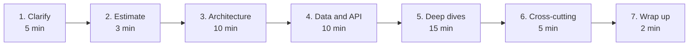
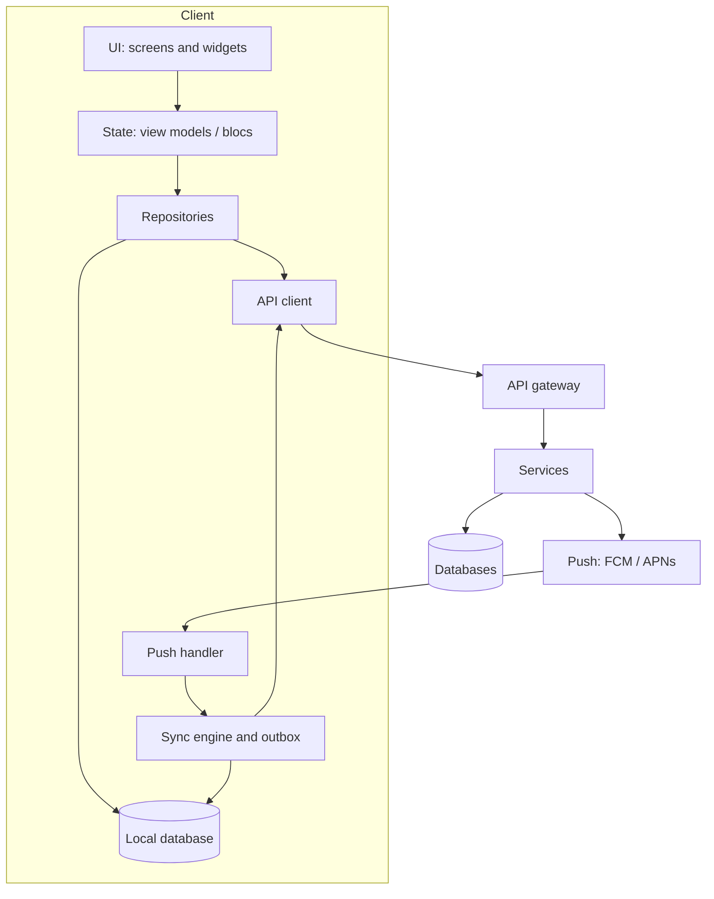

# The framework

A mobile system design round is 45 to 60 minutes. Interviewers aren't checking whether you reach "the right answer". They want to see you **find the hard parts of the problem, make trade-offs out loud, and go deep where it matters**.

This is the order that works. Spend roughly the time shown, and say out loud which step you're on.

## 1. Clarify the requirements

Never start drawing. Ask questions until you can write two short lists.

**Functional:** what the user can do. Pick three or four core features and say which ones you're leaving out.

**Non-functional:** what makes the mobile version hard. Go through this list every time:

| Ask about | Why it changes the design |
|---|---|
| **Offline** | Read-only offline needs a cache. Write offline needs an outbox, conflict rules and a sync engine. |
| **Freshness** | "Within a second" means a socket or push. "Within a minute" means polling or pull-to-refresh is fine. |
| **Scale** | Users, items per user, payload sizes. Decides pagination, local database size and cache eviction. |
| **Devices and networks** | Low-end Android with 2 GB of RAM on 3G behaves nothing like an iPhone on Wi-Fi. |
| **Platforms** | iOS, Android, web, wearables. Background execution rules differ a lot. |
| **Security and compliance** | Money, health or children's data brings encryption, audit and data-residency rules. |
| **Battery** | Anything running in the background or using GPS or Bluetooth must justify its battery cost. |

> **Say it:** "I'll assume Android and iOS, a million daily users, and that people use it on patchy mobile data. Offline reads are a must; offline writes are nice to have. Does that match what you had in mind?"

## 2. Estimate

Two or three numbers are enough, and they should **drive a decision**. Estimates that don't change anything waste time.

- **Payload sizes:** a feed item is about 1 KB of JSON plus a 100–300 KB image. A page of 20 items costs about 5 MB with images, so prefetch carefully on mobile data.
- **On-device storage:** 10,000 chat messages at 500 bytes is 5 MB. Easy for SQLite. 10,000 photos isn't, so store thumbnails and fetch full images on demand.
- **Request rates:** one location update every 4 seconds from 100,000 drivers is 25,000 writes a second. That's why the server side uses a different store for live locations.
- **Battery:** GPS at high accuracy costs several percent of battery an hour. Bluetooth scanning, wake locks and radio wake-ups add up too.

## 3. Draw the architecture

Draw the **client** in layers, then the **backend** as boxes. Mobile interviews care much more about the client.

Points to make while drawing:

- **The local database is the source of truth for the UI.** Screens watch the database. The network writes into the database. That's how you get offline support, instant startup and consistent screens for free.
- **Repositories hide where data comes from.** The UI never knows whether data came from the cache or the network.
- **Background work is a separate component** with its own constraints (Android WorkManager, iOS BGTaskScheduler, foreground services).

## 4. Data model and API

Write down the **two or three entities** that matter, with the fields that drive behaviour (IDs, timestamps, status, version). Then the API calls the client makes.

Decisions to state explicitly:

| Decision | Usual mobile choice | When to choose differently |
|---|---|---|
| IDs | Client-generated UUIDs (v7 sorts by time) | Never use server-only IDs for things the user creates offline |
| Pagination | Cursor (`?after=<opaque>`) | Offset only for small, static lists |
| Writes | Idempotency key per user action | Always for payments and anything not safe to repeat |
| Real-time | Push to wake, socket while in the foreground, poll as fallback | Server-sent events or long-polling where sockets are blocked |
| Format | JSON, gzip | Protobuf when payloads are large or frequent (location, telemetry) |
| Versioning | Additive changes, clients ignore unknown fields | A minimum supported version plus force update for breaking changes |

## 5. Deep dives

The interviewer will push on one or two areas. If they don't, **choose the hardest part of the problem yourself**, say why, and go deep. Good candidates:

- Sync and conflict resolution
- A state machine for something that can fail halfway (payments, trips, uploads)
- Real-time delivery and ordering
- Caching and invalidation
- Background execution under OS limits
- Very large lists, images and memory

Name the failure modes as you go: **what happens if the app is killed here, the network drops here, or this request is sent twice?**

## 6. Cross-cutting concerns

Run through these quickly. One sentence each shows maturity.

- **Security:** tokens in the Keychain or Keystore, certificate pinning for sensitive apps, no PII in logs, jailbreak and root signals for money apps.
- **Observability:** crash reporting, structured logs with a request ID, client-side performance traces, funnel analytics.
- **Releases:** feature flags, staged rollouts, kill switches, a forced-update path. A mobile release can't be rolled back, so every risky change ships behind a flag.
- **Accessibility and localisation:** screen readers, dynamic type, right-to-left, Indian languages.
- **Testing:** unit tests for the sync engine and state machines, fakes for the network, a few end-to-end tests of the critical path.

## 7. Wrap up

Summarise the design in three sentences, name the **biggest risk** and say what you'd build next with more time. This is where seniority shows: you know what you didn't solve.

---

## Common mistakes

1. **Designing the backend in detail.** Unless asked, keep the server at box level and spend your time on the client.
2. **No offline story.** Every mobile design needs one, even if it's "read-only from cache".
3. **Trusting the client.** Prices, balances, permissions and payment status come from the server. The client only displays and requests.
4. **Ignoring app lifecycle.** The OS can kill your app at any time. Anything in memory only is already lost.
5. **One giant state object.** Split state by feature and by lifetime (session, screen, ephemeral).
6. **Forgetting the second request.** Retries, double taps and duplicate push messages happen daily. Make writes idempotent and handlers safe to run twice.

Next: [Building blocks](building-blocks.md), the patterns every case study reuses.
